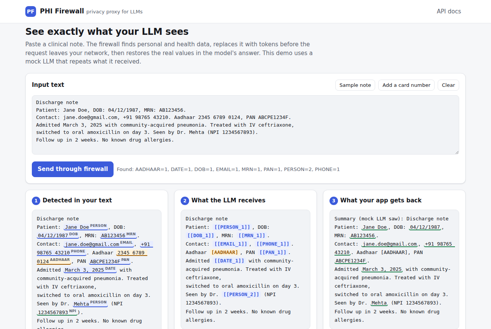
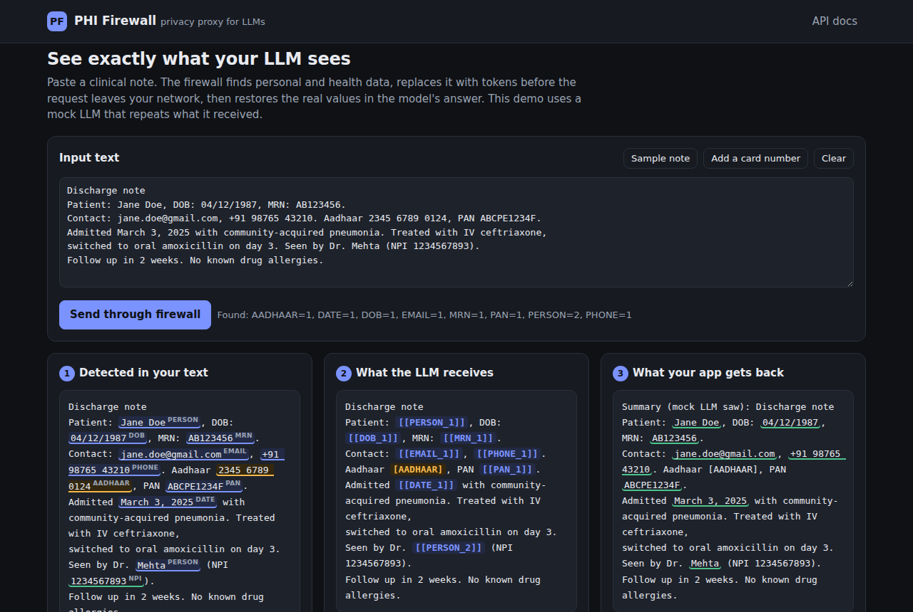
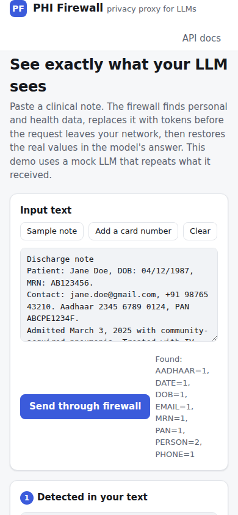

# PHI Firewall - keep patient data out of your LLM prompts

  

**PHI Firewall** is a drop-in proxy that sits between your app and any LLM API. It finds
personal and health data (names, dates of birth, MRNs, emails, phones, **Aadhaar, PAN**, SSNs…),
swaps it for tokens like `[[PERSON_1]]` **before** the request leaves your network, and puts the
real values back into the model's answer. The LLM does its job; it just never sees who the patient is.

```
Your app                        PHI Firewall                              LLM provider
"Patient: Jane Doe,   ──►  detect ─► tokenize ─► encrypt map  ──►  "Patient: [[PERSON_1]],
 DOB 04/12/1987 ..."                  (AES-256-GCM vault)            DOB [[DOB_1]] ..."
                                                                          │
"Jane Doe should      ◄──  rehydrate tokens ◄─────────────────────  "[[PERSON_1]] should
 follow up in 2 wks"       + tamper-evident audit log                follow up in 2 wks"
```

## Why this matters

Hospitals, insurers and health-tech startups want to use LLMs, but sending patient data to a third
party is a compliance risk (HIPAA in the US, DPDP Act in India). Most teams either don't use LLMs
at all, or copy-paste redaction code into every service. A firewall does it **once, centrally**:

- **Works with existing code** - it speaks the OpenAI `/v1/chat/completions` format; point your SDK's `base_url` at it.
- **Reversible where it helps, permanent where it must be** - per-entity policy: tokenize, mask, block or allow.
- **India-aware** - Aadhaar numbers are confirmed with the **Verhoeff checksum**, PAN with its holder-type rule. Most open-source redactors only know US formats.
- **Encrypted vault** - token maps are stored with **envelope encryption** (AES-256-GCM data keys wrapped by a master key; KMS-ready, supports key rotation).
- **Tamper-evident audit log** - every record is hash-chained to the previous one; edit or delete a line and `verify` points to it. It never stores PHI values, only counts.

## Quick start (no LLM account needed)

```bash
git clone https://github.com/Noella-John1997/phi-firewall.git
cd phi-firewall
python -m venv .venv && source .venv/bin/activate      # Windows: .venv\Scripts\activate
pip install -e ".[dev]"

# 1) See what gets redacted
phi-firewall scan "Patient: Jane Doe, DOB: 04/12/1987, Aadhaar 2345 6789 0124, email jane@x.com"

# 2) Run the proxy with a mock LLM
export PHI_FIREWALL_MASTER_KEYS=$(phi-firewall gen-key)     # Windows PowerShell: see below
phi-firewall serve                                          # http://127.0.0.1:8000/docs

# 3) In another terminal, run the demo
python examples/demo_client.py
```

Windows PowerShell: `$env:PHI_FIREWALL_MASTER_KEYS = (phi-firewall gen-key)`

Run the tests: `pytest -q`

### Use a real LLM

```bash
export UPSTREAM_BASE_URL=https://api.openai.com/v1
export UPSTREAM_API_KEY=sk-...
phi-firewall serve
python examples/use_with_openai_sdk.py
```

Any OpenAI-compatible endpoint works (Azure OpenAI, Groq, Together, a local vLLM or Ollama server).

### Docker

```bash
docker build -t phi-firewall .
docker run -p 8000:8000 -e PHI_FIREWALL_MASTER_KEYS=$(phi-firewall gen-key) phi-firewall
```

## Web demo



The proxy serves a demo page at `/`. Paste a note and press **Send through firewall** to see three panels:
**1. detected** (colour = policy action) → **2. what the LLM receives** (tokens) → **3. what your app gets back**
(real values restored, underlined green). Add a card number to see the request get blocked, and
verify the audit hash chain with one click.

| Dark mode | Phone |
| --- | --- |
|  |  |

**Put it online for free** (Render or Hugging Face Spaces, mock LLM so it costs nothing): see [`deploy/`](deploy/).
`Live demo: https://phi-firewall.onrender.com` *(replace with your URL)*

## API

| Method & path | What it does |
| --- | --- |
| `POST /v1/chat/completions` | OpenAI-compatible. Redacts every message, forwards, restores tokens in the answer. Adds `X-PHI-Entities` and `X-PHI-Firewall-Request-Id` headers. |
| `POST /v1/scan` | `{"text"}` → detected spans with positions and policy actions + redacted preview. Stores nothing. |
| `GET /v1/policy` | Active policy |
| `GET /v1/audit/tail?n=20` | Latest audit records (counts only) |
| `POST /v1/redact` | `{"text": ...}` → redacted text + `request_id` (mapping kept encrypted in the vault until TTL) |
| `POST /v1/rehydrate` | `{"request_id", "text"}` → text with tokens restored. For async / multi-step pipelines. |
| `GET /v1/audit/verify` | Checks the audit log hash chain |
| `GET /health` | Liveness |

Interactive docs at `http://127.0.0.1:8000/docs` once the server runs.

## What it detects

| Entity | How | Default action |
| --- | --- | --- |
| `PERSON` | Cue words (`Patient:`, `Mr.`, `Dr.`…); optional Presidio NER | tokenize |
| `DOB`, `DATE` | Date formats; DOB when preceded by "DOB / born / date of birth" | tokenize |
| `MRN` | "MRN" / "medical record number" + ID | tokenize |
| `EMAIL`, `PHONE` | Regex (Indian +91 and US formats) | tokenize |
| `AADHAAR` | 12 digits + **Verhoeff checksum** | mask |
| `PAN` | `AAAAA9999A` + holder-type check | tokenize |
| `SSN` | Format + invalid-range rules | mask |
| `CREDIT_CARD` | 13–19 digits + **Luhn checksum** | **block** (HTTP 422) |
| `NPI` | 10 digits + Luhn with 80840 prefix | allow (public registry) |
| `IP_ADDRESS` | IPv4 | mask |

Change any of these in [`phi_firewall/policy/default_policy.yaml`](phi_firewall/policy/) or point
`POLICY_PATH` at your own file.

## Configuration (environment variables)

| Variable | Default | Meaning |
| --- | --- | --- |
| `PHI_FIREWALL_MASTER_KEYS` | temporary key (warning) | `kid:base64` list, first is active. Rotate by adding a new key in front. |
| `UPSTREAM_BASE_URL` | `mock` | LLM API base URL, or `mock` |
| `UPSTREAM_API_KEY` | - | Key for the upstream LLM |
| `FIREWALL_API_KEYS` | - | If set, clients must send `X-Firewall-Key` |
| `VAULT_PATH` | `vault.db` | SQLite file for the encrypted token vault |
| `VAULT_TTL_SECONDS` | `900` | How long token maps live |
| `AUDIT_LOG_PATH` | `audit.jsonl` | Audit log file |
| `POLICY_PATH` | built-in | Custom policy YAML |

See `.env.example`.

## Project layout

| Folder | What's inside |
| --- | --- |
| [`phi_firewall/`](phi_firewall/) | The package |
| [`phi_firewall/detectors/`](phi_firewall/detectors/) | Regex + checksum detectors, overlap resolution |
| [`phi_firewall/redaction/`](phi_firewall/redaction/) | Tokenize / mask / rehydrate |
| [`phi_firewall/policy/`](phi_firewall/policy/) | Per-entity actions (YAML) |
| [`phi_firewall/vault/`](phi_firewall/vault/) | Envelope encryption, key providers, SQLite vault |
| [`phi_firewall/audit/`](phi_firewall/audit/) | Hash-chained audit log |
| [`phi_firewall/proxy/`](phi_firewall/proxy/) | FastAPI app and upstream clients |
| [`phi_firewall/web/`](phi_firewall/web/) | Browser demo served at `/` |
| [`deploy/`](deploy/) | Free hosting guides (Render, Hugging Face, Docker) |
| [`docs/`](docs/) | Screenshots |
| [`tests/`](tests/) | pytest suite |
| [`examples/`](examples/) | Demo client, OpenAI SDK example, sample clinical note |

## Limitations

- Regex + cue-word name detection misses names with no cue ("Jane came in today"). Install the
  `presidio` extra for NER, and treat this as **one layer** of defence, not a compliance certificate.
- Streaming responses (`stream: true`) are not supported yet.
- The vault is SQLite - fine for one machine; use Redis or DynamoDB for many replicas.
- Tokens can be split by the LLM in rare cases (e.g. `[[PERSON_1]]'s`) - handled, but paraphrased tokens won't rehydrate.

## Roadmap

Streaming rehydration · Presidio + fine-tuned clinical NER · Redis vault · Prometheus metrics ·
per-tenant policies · format-preserving fake values (e.g. a realistic fake name instead of a token).

## License

MIT - see [LICENSE](LICENSE).
